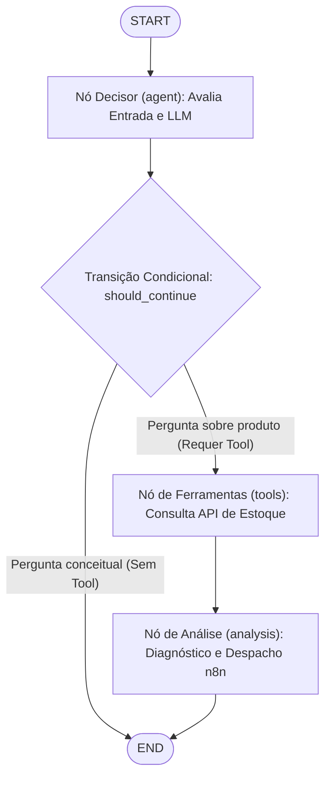
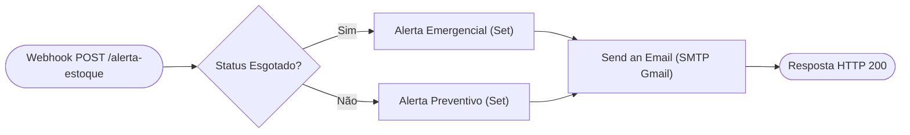

# 📦 StockFlow Agent — Agente Inteligente de Gestão de Estoque

[](https://www.python.org/)
[](https://github.com/langchain-ai/langgraph)
[](http://150.136.45.59:8082/docs)
[](https://n8n.io/)
[](docs/evidencias_testes.md)

---

## 🎯 1. Problema e Objetivo da Aplicação

### 1.1 O Desafio de Negócio
Em empresas de varejo e centros de distribuição, o controle manual de estoque é frequentemente sujeito a falhas operacionais críticas:
- **Ruptura de Estoque (Stockout):** Falta de produtos de alta demanda por atraso na identificação de estoques zerados ou abaixo da margem de segurança.
- **Excesso de Capital Imobilizado:** Compras excessivas descoladas da política de estoque mínimo e do giro de estoque.
- **Falta de Comunicação Ágil:** Falha na notificação imediata aos compradores e encarregados de suprimentos quando um produto atinge níveis críticos.

### 1.2 A Solução: StockFlow Agent
O **StockFlow Agent** é um agente inteligente de tomada de decisão baseado em **LangGraph**, projetado para:
1. **Consultar e monitorar produtos em tempo real** através de integração com uma API Cloud de Estoque.
2. **Avaliar autonomamente os níveis de inventário**, comparando o saldo atual contra o estoque mínimo de segurança.
3. **Disparar automações ativas com n8n** via webhooks HTTP seguros, despachando e-mails formatados e segmentados (*Alerta Emergencial* vs *Alerta Preventivo*) para a equipe de compras.
4. **Esclarecer dúvidas conceituais** de logística e supply chain diretamente via LLM, sem chamadas externas desnecessárias.

---

## 🧭 2. Arquitetura da Solução

A solução adota uma arquitetura em camadas orientada a grafos com separação clara de responsabilidades:



### 2.1 Componentes do LangGraph
- **`START`:** Ponto de entrada que injeta a solicitação do usuário e o `SYSTEM_PROMPT` no estado compartilhado (`AgentState`).
- **Nó Decisor (`agent`):** Avalia o histórico de conversação utilizando a LLM vinculada às ferramentas disponíveis (`consultar_produto_tool`, `listar_produtos_tool`, `verificar_saude_api_tool`).
- **Transição Condicional (`should_continue`):**
  - Se o modelo identificou a necessidade de dados de catálogo $\rightarrow$ roteia para **`tools`**.
  - Se a pergunta é puramente conceitual $\rightarrow$ encerra o ciclo diretamente em **`END`** (zero requisições externas).
- **Nó de Ferramentas (`tools`):** Executa a chamada HTTP contra a API Cloud com tratamento defensivo para erros `404` (inexistente) e `503` (indisponibilidade).
- **Nó de Análise de Negócio (`analysis`):** Classifica a situação do produto (`disponivel`, `baixo`, `esgotado`), sintetiza a resposta final com orientações de compra e dispara o webhook HTTP para o n8n caso o estoque esteja em nível de atenção.
- **`END`:** Garante parada determinística e acíclica do grafo, prevenindo loops infinitos.

---

## 🛠️ 3. Tecnologias Utilizadas

| Tecnologia | Finalidade no Projeto |
| :--- | :--- |
| **Python 3.10+** | Linguagem principal do agente e suíte de testes |
| **LangGraph / LangChain** | Orquestração de grafo de estados (`StateGraph`), histórico e ferramentas tipadas |
| **Google Gemini API** | Modelo de Linguagem primário para raciocínio e tool calling |
| **FastAPI** | API de Estoque Cloud hospedada externamente com catálogo de produtos |
| **n8n Cloud** | Plataforma de automação de fluxo para disparo de e-mails via Webhook |
| **SMTP Seguro (Google)** | Transporte TLS/SSL autenticado para notificações por e-mail |
| **Git / GitHub** | Controle de versão estrito via Gitflow com PRs protegidos para branch `dev` |

---

## 🚀 4. Instruções de Setup e Execução Passo a Passo

### 4.1 Pré-requisitos
- **Python 3.10** ou superior instalado (`python3 --version`).
- Acesso à internet para comunicação com a API de Estoque Cloud e Webhook do n8n.

### 4.2 Clonando o Repositório
```bash
git clone https://github.com/RSC-SC/stockflow-agent.git
cd stockflow-agent
git checkout dev
```

### 4.3 Criando e Ativando o Ambiente Virtual
```bash
# Linux / macOS
python3 -m venv .venv
source .venv/bin/activate

# Windows
python -m venv .venv
.venv\Scripts\activate
```

### 4.4 Instalando as Dependências
```bash
pip install --upgrade pip
pip install -r requirements.txt
```

### 4.5 Configuração das Variáveis de Ambiente
Copie o arquivo de exemplo `.env.example` para `.env`:
```bash
cp .env.example .env
```

Edite o arquivo `.env` preenchendo suas configurações:
```env
# URL da API de Estoque na Cloud
STOCK_API_BASE_URL=http://150.136.45.59:8082

# URL do Webhook do n8n na Cloud
N8N_WEBHOOK_URL=http://150.136.45.59:5678/webhook/alerta-estoque

# Configurações de e-mail para os alertas disparados no n8n
ALERT_EMAIL_TO=rsc_sc@hotmail.com
ALERT_EMAIL_FROM=rafaeldossantoscunha@gmail.com
ALERT_SENDER_NAME=StockFlow Bot

# Chave de API da LLM (Google Gemini ou OpenAI)
GEMINI_API_KEY=sua_chave_gemini_aqui
```

---

## 💻 5. Modos de Execução da Aplicação

### 5.1 Modo Interativo no Terminal (Console REPL)
Inicie o console conversacional completo:
```bash
python3 -m src.main
```
Dentro do console interativo, você pode conversar naturalmente com o agente ou usar comandos de atalho:
- `catalogo` $\rightarrow$ Lista todos os produtos cadastrados.
- `status-api` $\rightarrow$ Verifica a conectividade com a API Cloud.
- `limpar` $\rightarrow$ Reinicia o histórico da conversa.
- `ajuda` $\rightarrow$ Exibe dicas e exemplos.
- `sair` $\rightarrow$ Encerra a aplicação.

### 5.2 Modo Consulta Direta (Single-shot via Linha de Comando)
Execute uma consulta pontual sem entrar no loop interativo:
```bash
python3 -m src.main --pergunta "Como está o estoque do produto PRD-001?"
```

---

## ⚡ 6. Automação Complementar com n8n

O fluxo do n8n atua como uma esteira de alerta para a equipe de suprimentos:



### 6.1 Como Importar o Workflow no n8n
1. Acesse o seu servidor n8n (ex: `http://150.136.45.59:5678`).
2. No menu lateral, clique em **Workflows** $\rightarrow$ **Add Workflow**.
3. No canto superior direito, clique nos três pontos `...` e selecione **Import from File**.
4. Selecione o arquivo [`n8n/workflow-estoque.json`](n8n/workflow-estoque.json) incluído neste repositório.
5. Configure suas credenciais de envio SMTP no nó **Send an Email**.
6. Ative o workflow alterando a chave no canto superior para **Active**.

Consulte a documentação completa em [`n8n/README.md`](n8n/README.md).

---

## 🧪 7. Resumo dos Testes e Evidências

O projeto foi validado rigorosamente nos **3 Cenários Obrigatórios de Avaliação**:

| Cenário | Entrada de Teste | Ferramenta Invocada | Diagnóstico do Agente | Disparo n8n | Status |
| :--- | :--- | :--- | :--- | :---: | :---: |
| **CEN-01** (Item Crítico) | `"Como está o estoque do produto PRD-001?"` | `consultar_produto_tool` | Saldo (5 un) < Mínimo (10 un) | **Sim (E-mail enviado)** | ✅ Aprovado |
| **CEN-02** (Item 404) | `"Qual o estoque do produto PRD-999?"` | `consultar_produto_tool` | Item inexistente informado com clareza | **Não (Zero alucinação)** | ✅ Aprovado |
| **CEN-03** (Pergunta Conceitual) | `"O que é estoque de segurança e para que serve?"` | **Nenhuma (0 tools)** | Resposta conceitual precisa via LLM | **Não (Zero requisição HTTP)** | ✅ Aprovado |

### 7.1 Execução da Suíte de Testes Automatizados
O repositório possui uma suíte com **34 testes automatizados** cobrindo todas as camadas (configuração, estado, ferramentas, grafo, CLI e cliente n8n):

```bash
python3 -c "
import inspect
from tests import test_config, test_state, test_graph, test_stock_tool, test_agent_flow, test_cli, test_n8n_client

modules = [test_config, test_state, test_graph, test_stock_tool, test_agent_flow, test_cli, test_n8n_client]
passed = 0
for mod in modules:
    for name, fn in inspect.getmembers(mod, inspect.isfunction):
        if name.startswith('test_'):
            fn()
            passed += 1
print(f'Total de testes aprovados: {passed}/34')
"
```
Resultado: **34/34 testes aprovados (100% de sucesso)**.  
O relatório completo com logs e payloads detalhados está disponível em [`docs/evidencias_testes.md`](docs/evidencias_testes.md).

---

## ⚠️ 8. Principais Limitações da Solução

1. **Dependência de Conectividade Externa:** O agente depende do acesso de rede aos servidores na nuvem (FastAPI e n8n) para consultas em tempo real e entrega de alertas.
2. **Operações em Modo Somente Leitura:** A versão atual realiza diagnóstico e disparo de alertas, mas não grava pedidos de compra diretamente na base de dados do ERP sem supervisão humana.
3. **Dependência de Credenciais SMTP no n8n:** Para entrega real de e-mails na caixa de entrada corporativa, o n8n requer conta SMTP válida e senha de app segura configuradas.

---

## 👥 9. Identificação dos Integrantes e Contribuições

- **Rafael Cunha** (`RSC-SC`):
  - Modelagem de arquitetura e especificação de requisitos.
  - Implementação do agente em Python com LangGraph (`src/agent/`).
  - Criação das ferramentas de integração com a API Cloud (`src/tools/`).
  - Construção e exportação do workflow automatizado no n8n (`n8n/`).
  - Desenvolvimento da interface CLI e console interativo (`src/main.py`).
  - Automação de testes e elaboração do relatório consolidado de evidências (`docs/`).

---

## 🎥 10. Vídeo Demonstrativo da Aplicação

> **Espaço Reservado para a Demonstração:**
> 
> 🔗 **Link do Vídeo:** *[Apresentação em Vídeo da Solução (Em breve)]*
> 
> *O vídeo contemplará a visão geral do problema, arquitetura do LangGraph, testes dos 3 cenários obrigatórios e o recebimento em tempo real do e-mail de alerta disparado pelo n8n.*
