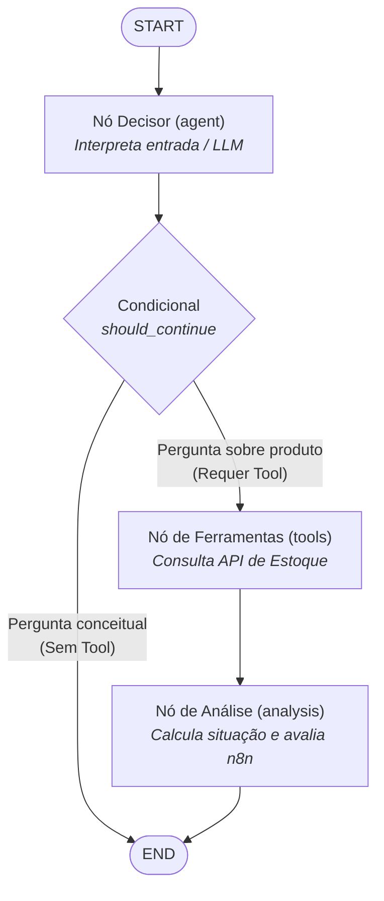

# Arquitetura do Agente com LangGraph

Este documento descreve a máquina de estados, o modelo de estado compartilhado e a topologia do grafo construído para o **StockFlow Agent**.

---

## 🧭 Diagrama do Grafo (StateGraph)

---

## 🧩 Componentes do Grafo

### 1. Nó Decisor (`agent`)
* **Papel:** Recebe o histórico de mensagens e analisa a intenção do usuário.
* **Comportamento:**
  * Se a pergunta for sobre um produto específico (ex: "Quantos mouses sem fio temos?"), aciona a tool de consulta à API.
  * Se for uma dúvida conceitual sobre estoque (ex: "O que é estoque de segurança?"), sintetiza a resposta diretamente.

### 2. Transição Condicional (`should_continue`)
* **Critério de Roteamento:**
  * Retorna `"tools"`: Quando o modelo gera uma chamada de ferramenta (`tool_calls`) ou o estado possui `stock_query` pendente.
  * Retorna `END`: Quando a resposta já foi resolvida sem ferramentas ou o atendimento foi finalizado.

### 3. Nó de Ferramentas (`tools`)
* **Papel:** Executa requisição HTTP contra a API de Estoque (`http://150.136.45.59:8082/produtos/{codigo}`).
* **Tratamento de Exceções:** Trata códigos HTTP 404 (produto não encontrado) e 503 (serviço indisponível) de forma graciosa.

### 4. Nó de Análise de Negócio (`analysis`)
* **Papel:** Compara `quantidade_atual` com `estoque_minimo` e classifica:
  * $\le 0$: **`esgotado`** (Gera alerta para o n8n)
  * $< \text{estoque\_minimo}$: **`baixo`** (Gera alerta para o n8n)
  * $\ge \text{estoque\_minimo}$: **`disponivel`** (Estoque regular)

### 5. Condição de Término (`END`)
* O grafo possui fluxo estritamente acíclico por turno de atendimento, garantindo que o agente encerre a execução sem loops infinitos.
