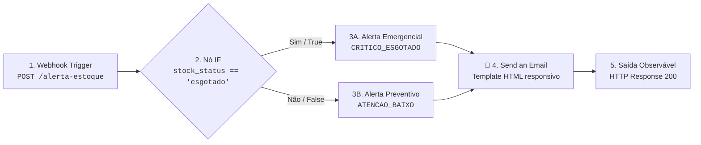

# Automação Complementar com n8n — Alertas de Estoque Crítico

Este diretório contém os artefatos de integração da aplicação **StockFlow Agent** com o **n8n**, em conformidade com os requisitos da **Seção 4.4** e a rubrica avaliativa do projeto (Critério 4: 1.5 pontos).

---

## 🧭 Visão Geral do Workflow

O workflow implementado no n8n na Cloud (`StockFlow - Alertas de Estoque Crítico.`) atua como uma esteira automatizada de notificação e governança para a equipe de compras e logística quando o agente de IA identifica situações críticas no inventário:



---

## 📋 Nós do Workflow e Responsabilidades

| Nó | Tipo | Função |
| :--- | :--- | :--- |
| **Webhook** | `n8n-nodes-base.webhook` (v2.1) | Gatilho HTTP recebendo requisições `POST` no path `alerta-estoque`. |
| **If** | `n8n-nodes-base.if` (v2.3) | Etapa de processamento/decisão avaliando se o status é `esgotado` (ruptura total) ou `baixo` (preventivo). |
| **Alerta Emergencial** | `n8n-nodes-base.set` (v3.5) | Formata o payload para urgência máxima com orientação de compra imediata. |
| **Alerta Preventivo** | `n8n-nodes-base.set` (v3.5) | Formata o payload de reposição programada contendo a quantidade atual e a margem de segurança. |
| **Send an Email** | `n8n-nodes-base.emailSend` (v2.1) | Dispara e-mail formatado em HTML com tokens de cor para o responsável pelo estoque via SMTP seguro. |

---

## 📨 Contrato de Dados (Payload do Webhook)

O agente Python despacha a notificação enviando um `POST` com o seguinte payload JSON:

```json
{
  "codigo": "PRD-001",
  "nome": "Mouse sem fio",
  "quantidade_atual": 5,
  "estoque_minimo": 10,
  "stock_status": "baixo",
  "email_destinatario": "rsc_sc@hotmail.com",
  "email_remetente": "rafaeldossantoscunha@gmail.com",
  "nome_remetente": "StockFlow Bot"
}
```

### Parâmetros Suportados:
* `codigo` *(string)*: Identificador único do produto no padrão `PRD-XXX`.
* `nome` *(string)*: Nome descritivo da mercadoria.
* `quantidade_atual` *(inteiro)*: Saldo físico verificado em estoque.
* `estoque_minimo` *(inteiro)*: Nível de segurança exigido.
* `stock_status` *(string)*: Classificação calculada pelo LangGraph (`baixo` ou `esgotado`).
* `email_destinatario` *(string)*: Destinatário do alerta.
* `email_remetente` *(string)*: Remetente autenticado no servidor SMTP.
* `nome_remetente` *(string)*: Nome de exibição no cabeçalho do e-mail.

---

## 📥 Como Importar o Workflow no n8n

1. No painel do seu n8n, acesse **Workflows**.
2. Clique no menu de opções (**`...`**) no canto superior direito e selecione **`Import from File`**.
3. Selecione o arquivo [`n8n/workflow-estoque.json`](./workflow-estoque.json).
4. Verifique as credenciais de SMTP no nó **`Send an Email`** e ative o workflow para o modo **`Active`**.
